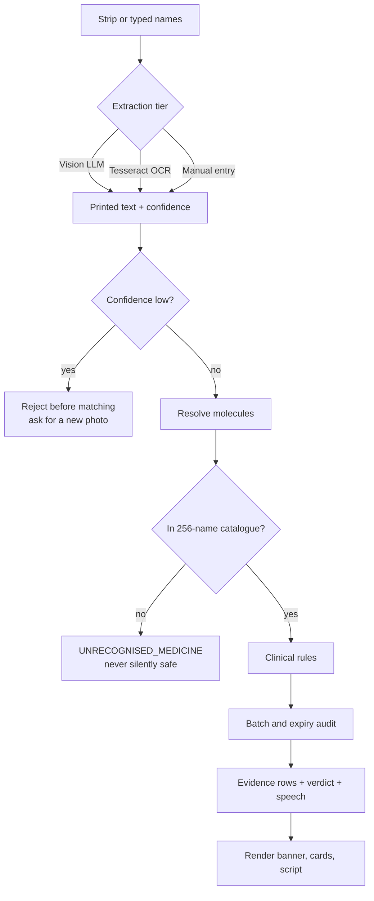

<div align="center">

# 🩺 KathaPulse AI

### *Understand Your Medicine. Protect Your Health.*

**A dialect-aware medicine-safety companion for Indian households and small pharmacies.**
Photograph a medicine strip — get a deterministic, explainable, tri-lingual warning *before*
you take two tablets that contain the same drug.

<sub>NeuraViz AI Challenge 2026–27 · **Stage 4 Finalist** · working POC **`v1.6.1`** · commit [`474a429`](https://github.com/saviochackoxavier-tech/kathapulse-ai/commit/474a429)</sub>

<br/>


**English** · **മലയാളം** · **हिन्दी**

</div>

---

## Table of contents

1. [Why KathaPulse exists](#1-why-kathapulse-exists)
2. [What it does](#2-what-it-does)
3. [System architecture & workflow](#3-system-architecture--workflow)
4. [Market differentiation](#4-market-differentiation)
5. [Explainability: evidence, not a score](#5-explainability-evidence-not-a-score)
6. [Security & safety safeguards](#6-security--safety-safeguards)
7. [Indian legal & regulatory governance](#7-indian-legal--regulatory-governance)
8. [Visual evidence gallery](#8-visual-evidence-gallery)
9. [Quick start](#9-quick-start)
10. [Configuration](#10-configuration)
11. [API reference](#11-api-reference)
12. [Testing](#12-testing)
13. [Repository layout](#13-repository-layout)
14. [Documentation & governance](#14-documentation--governance)
15. [Known limitations](#15-known-limitations)
16. [Contributing](#16-contributing)
17. [License](#17-license)

---

## 1. Why KathaPulse exists

India's medicine shelves are full of the same molecule wearing different names. A patient with
fever takes **Dolo 650** and **Crocin Cold & Flu** — both paracetamol — and reaches 1,300 mg in a
single sitting. A BP patient refills **Telma 40** and is handed **Telma-H**, which adds
hydrochlorothiazide to the telmisartan they are already taking. A diabetes patient picks
**Glycomet** and **Glycomet-GP**, one letter apart, different contents.

None of these people are careless. They are reading a foil printed in a script they can read but
whose *pharmacology* they were never taught, in a language most scanning apps do not speak.

| The failure mode | What KathaPulse does about it |
|---|---|
| **Overlapping salts** across two brands | Resolves every strip to molecules, then flags the duplicate *before* the verdict |
| **Look-alike shelf neighbours** (Telma / Telma-H, Amaryl / Amlopres) | Separate LASA pass with verification wording, not a composition claim |
| **Paracetamol ceiling** (4,000 mg/day adult) | Cumulative dose check across the whole scan, repeated in the reminder engine |
| **Recalled or expired batches** | Offline batch/expiry audit with a pharmacovigilance caveat |
| **Language** | Every warning, action and spoken script exists in Malayalam, Hindi and English |
| **Privacy** | Photo processed in RAM, never written to disk, no accounts, no cookies |
| **Bad photos** | Refuses or asks for a retake instead of guessing a medicine |

**The core design rule:** a wrong guess is more dangerous than "I don't know". The language model
only *reads the foil*. Every warning is produced by explicit, unit-tested rules over a fixed
catalogue.

---

## 2. What it does

```
photograph strip → read printed text → resolve molecules → run clinical rules
      → audit batch & expiry → explain the evidence → speak it in ml/hi/en
      → schedule the next dose locally
```

| Capability | Status in this build |
|---|---|
| Photo identification (vision LLM → OCR → manual fallback) | Implemented, **live vision key not configured** (`vision_keys: 0`) |
| Duplicate-salt, paracetamol ceiling, 29 interaction pairs, same-class overlap, LASA | Deterministic, 100% on a 44-case labelled corpus |
| Explainable evidence card (name / strength / active ingredient provenance) | Per-field status + verifying database + review date |
| Confidence gate (`high` / `medium` / `low`) | Low refuses before matching; medium holds a retake verdict |
| Batch recall + expiry + cold-chain audit | 4 curated **pilot** notices, 15 printed expiry shapes parsed |
| Tri-lingual UI, findings and speech | ml / hi / en, asserted by tests |
| Local audio pack tier (recorded clips) | Loader + manifest ship **empty**; device voice is the fallback |
| Dose reminders with countdown | Server derives, browser holds in memory, `1-0-1`/BD/TDS/every 8 h |
| Offline-first PWA shell | Service worker `kathapulse-v10`; scans are never cached |
| Read-only catalogue feeds | `GET /knowledge.json`, `GET /taxonomy.json` |

**Five one-tap demo presets** run the pilot cases with no camera, no key and no network egress:
Telma 40 + Telma-H, Dolo 650 + Crocin Cold & Flu, Amaryl 1 mg, Glycomet 500 batch audit
(recalled + expired), Glycomet GP ground truth.

---

## 3. System architecture & workflow

### 3.1 End-to-end pipeline

```
┌─────────────────────── CLIENT · mobile browser / installed PWA ────────────────────────┐
│                                                                                        │
│   camera capture  ──or──  gallery pick                                                 │
│          │                                                                             │
│          ▼                                                                             │
│   ┌──────────────────────┐   The canvas holds pixels only. It has nowhere to put EXIF,  │
│   │  canvas re-encode    │   GPS, XMP, IPTC, timestamps or a device serial.            │
│   │  static/js/capture.js│   Orientation is baked into the pixels first.              │
│   └──────────┬───────────┘   ≤1600 px long edge · JPEG · ≤6 MiB                        │
│              │                                                                         │
│              │  scrubbed JPEG bytes (multipart/form-data)                              │
└──────────────┼─────────────────────────────────────────────────────────────────────────┘
               │  HTTPS · Cache-Control: no-store on every response
               ▼
┌──────────────────── SERVER · FastAPI 0.115 · stateless · no writable path ─────────────┐
│                                                                                        │
│  POST /verify-strip        multipart image + language + paracetamol_taken_today_mg      │
│  POST /verify-medicines    JSON names (+ optional batch_no, expiry, age_years)          │
│  POST /verify-strips/batch multipart 1–5 strips, concurrency cap 3                      │
│              │                                                                         │
│              ▼                                                                         │
│   ┌──────────────────────────────────────────────────────────────────────────────┐     │
│   │ 1 · VALIDATE      magic bytes · content type · 6 MiB · Pydantic extra="forbid"│     │
│   └───────────────┬──────────────────────────────────────────────────────────────┘     │
│                   ▼                                                                    │
│   ┌──────────────────────────────────────────────────────────────────────────────┐     │
│   │ 2 · READ          bytes in RAM, io.BytesIO for OCR — no tempfile, no cache    │     │
│   └───────────────┬──────────────────────────────────────────────────────────────┘     │
│                   ▼                                                                    │
│   ┌──────────────────────────────────────────────────────────────────────────────┐     │
│   │ 3 · EXTRACT       tier 1  vision LLM  (OpenAI-compatible, Groq demo model)    │     │
│   │                   tier 2  local Tesseract OCR                                 │     │
│   │                   tier 3  manual entry (user types the printed name)          │     │
│   │                                                                               │     │
│   │   dual-key failover: primary 401/403/429 ──► fallback key, same request,      │     │
│   │   the rejected key is not retried. /health exposes counts, never values.      │     │
│   └───────────────┬──────────────────────────────────────────────────────────────┘     │
│                   ▼                                                                    │
│   ┌──────────────────────────────────────────────────────────────────────────────┐     │
│   │ 4 · RESOLVE       48-molecule taxonomy (15 fixed combinations)                │     │
│   │                   ──► 256-name Kerala catalogue, provenance 2026-11-25        │     │
│   │                   space/dash-insensitive, 0.88 similarity floor, superset wins│     │
│   └───────────────┬──────────────────────────────────────────────────────────────┘     │
│                   ▼                                                                    │
│   ┌──────────────────────────────────────────────────────────────────────────────┐     │
│   │ 5 · DECIDE — pure functions, no model in the decision path                    │     │
│   │   clinical.py  DUPLICATE_SALT · PARACETAMOL_DAILY_MAX (4000 mg) ·             │     │
│   │                INTERACTION (29 pairs) · DUPLICATE_CLASS · LASA_RISK ·         │     │
│   │                AGE_WARNING · UNRECOGNISED_MEDICINE                           │     │
│   │   recall.py    RECALLED_BATCH · EXPIRED_STOCK · EXPIRY_SOON ·                 │     │
│   │                EXPIRY_UNREADABLE · COLD_CHAIN_RISK                            │     │
│   │   audio_reminders.py  schedule parser + paracetamol ceiling refusal           │     │
│   └───────────────┬──────────────────────────────────────────────────────────────┘     │
│                   ▼                                                                    │
│   ┌──────────────────────────────────────────────────────────────────────────────┐     │
│   │ 6 · RESPOND       verdict · localised findings · evidence rows · speech       │     │
│   │                   processed_in_memory: true · Cache-Control: no-store         │     │
│   └──────────────────────────────────────────────────────────────────────────────┘     │
└───────────────────────────────────┬────────────────────────────────────────────────────┘
                                    ▼
┌──────────────────────── CLIENT · render and speak ─────────────────────────────────────┐
│  banner (recall / expiry)  →  verdict  →  provenance + script  →  countdown            │
│  →  findings  →  detected medicines  →  reminder form  →  disclaimer                   │
│                                                                                        │
│  audio tier 0  local clip pack  ─►  tier 1  SpeechSynthesis (ml-IN / hi-IN)             │
│                                 └►  tier 2  written warning in large type               │
└────────────────────────────────────────────────────────────────────────────────────────┘
```

### 3.2 Decision order (why the verdict is deterministic)



### 3.3 Offline / PWA behaviour

```
service worker kathapulse-v10
├── navigation (/)         network-first  → cached shell fallback
├── /static/*, feeds        cache-first    → stale-while-revalidate
├── every non-GET (scan)    untouched      → never cached, queued or replayed
└── cross-origin            untouched
```

The cache lives on the patient's own phone. Server-side zero persistence is unchanged: no cache
directory, no volume, no database.

---

## 4. Market differentiation

This table compares **publicly stated** capabilities as read on 25 November 2026. It is not a
benchmark, no competitor was tested, and "not stated publicly" means exactly that — not that a
feature is absent.

| | **KathaPulse AI** | **Pill IQ** | **PharmaScan AI** | **MedLingual** | **MedScan** | **MedicineWatch India** | **DoseBell** |
|---|---|---|---|---|---|---|---|
| **What it is** | Strip-safety workflow for Indian households/pharmacies | AI packaging scanner, 1,200+ medicines | AI medicine & pill identifier | OTC label scanner with translation | Reads a label's purpose aloud, senior-friendly | Checks a batch against CDSCO quality alerts | **No public product verified under this name** |
| **Duplicate-salt / interaction rules** | **Yes — deterministic**, 29 curated pairs | Interaction reports as a Premium feature; method not public | Interactions listed | Not stated | Not stated | No — batch alerts only | Not verifiable |
| **Recall / batch / expiry audit** | **Yes** — 4 pilot notices, expiry parse, cold-chain flag | Not stated | Not stated | Not stated | Not stated | **Yes — core feature**, CDSCO-sourced | Not verifiable |
| **Malayalam + Hindi + English** | **Yes, all 81 strings** | English interface | Not stated | 6 languages, **no Malayalam** | Many, including Malayalam | Not stated | Not verifiable |
| **Scan explainability** | **Per-field evidence + database + review date** | Plain-language summary; sourcing not public | Plain-language info | Translation of OpenFDA content | Reads the label purpose | Links to the official alert | Not verifiable |
| **Privacy posture** | RAM only, no disk, no cache, no accounts | Photos "used only to identify"; history saved in-app | Not stated | Not stated | Not stated | Server-side web app | Not verifiable |
| **Dose reminders** | **Yes** — local, spoken, page must stay open | Not stated | Not stated | Listed as a feature | Not stated | No | Not verifiable |
| **Offline** | Installable PWA with cached shell + catalogue | Not stated | Not stated | Not stated | Not stated | Not stated | Not verifiable |
| **Price** | Free prototype, no paid tier | Free 3 scans/day, ₹100/month | Free + IAP | Not stated | Free | Free | Not verifiable |

### The honest differentiator

Not "AI scans medicine" — that already exists. The defensible claim is the **combination**:

> a refusal-first safety engine (rules, not model output) **+** evidence that can be audited field
> by field **+** a real batch/expiry audit **+** Malayalam/Hindi parity **+** zero server-side image
> persistence, in one workflow built for a 320 px phone.

**What this table does not claim:** that KathaPulse is more accurate than any competitor; that an
unlisted feature is missing; or that it is the first multilingual medicine scanner. *DoseBell* could
not be verified and no capability is asserted for it.

The full matrix, with sources and caveats, is in [`docs/SUBMISSION_OVERVIEW.md`](docs/SUBMISSION_OVERVIEW.md#4-honest-positioning-against-six-products).

---

## 5. Explainability: evidence, not a score

Every scan returns one `evidence` row per strip. A field is only "verified" when a database actually
confirmed it.

| Field | `matched` / `verified` means |
|---|---|
| **Medicine name** | the label resolved **and** the reading tier did not report itself unsure |
| **Strength** | the number came from the foil (including a strength printed in the brand, `Dolo 650`) or the brand's fixed-combination record — never from a molecule default |
| **Active ingredient** | a database confirmed the molecule; the row names it (`taxonomy` or `ground_truth`) and the catalogue review date (`2026-11-25`) |

A molecule-level default strength renders as **Unverified**, because the camera never read it.

### Confidence gate

| Reported confidence | Behaviour |
|---|---|
| `low` | refused **before** matching (`rejection: low_confidence`) and the user is asked for a new photo |
| `medium` | molecules resolve, but `recapture_required` holds the verdict at *Could not verify* and the retake prompt is spoken |
| absent / unrecognised | nothing changes — a silent model is neither promoted nor rejected |

OCR has no self-report, so confidence is derived: an exact catalogue hit is `high`, anything that
needed the fuzzy step is `medium`. Manual entry carries none.

---

## 6. Security & safety safeguards

| Control | Implementation | Verified by |
|---|---|---|
| **EXIF / GPS / device metadata removed** | every capture and gallery pick is re-encoded through `<canvas>`; orientation baked in first | `tests/js/exif-scrub.test.mjs` — 15 checks with a real JPEG codec |
| **Volatile memory only** | upload read into `bytes`; OCR decodes from `io.BytesIO`; nothing written to disk | AST test forbids `tempfile` / `open()` / `shutil` in the request path |
| **No retention** | `Cache-Control: no-store` on every response; service worker never caches a POST | `tests/test_nextgen.py`, `tests/test_hardening.py` |
| **Strict contracts** | Pydantic v2 models with `extra="forbid"`; free text charset-whitelisted and capped at 120 chars | `tests/test_hardening.py`, `tests/test_api.py` |
| **Prompt-injection resistance** | model output is parsed into fixed models; unrecognised text is only fuzzy-matched against a closed catalogue; nothing the model says can trigger an action | `tests/test_vision.py` |
| **Secret isolation** | keys read from environment per request; `.env` git-ignored; `/health` reports *whether* a tier exists, never a value | `tests/test_hardening.py`, archive credential scan |
| **Upload limits** | magic-byte check, 6 MiB cap, ≤5 strips, ≤10 medicines, 1600 px long edge | `tests/test_api.py`, `tests/test_nextgen.py` |
| **Schema occlusion** | `/docs`, `/redoc`, `/openapi.json` return `no-store` 404 unless `KATHA_DOCS_ENABLED=1` | `tests/test_hardening.py` |
| **Rate limiting** | edge rules in `deploy/`; optional in-app sliding window (`KATHA_RATE_LIMIT_PER_MIN`, off by default) | `tests/test_ratelimit.py` |
| **Relay is closed by default** | `/ws/relay` refuses every connection without `KATHA_RELAY_SECRET`, HMAC tickets, 8-peer rooms, 2 KB frames, no transcript | `tests/test_nextgen.py` |
| **Container posture** | non-root uid 10001, no writable layer, 6 pinned dependencies, healthcheck, no baked secrets | `tests/test_hardening.py` |
| **No accounts at all** | no cookies, no sessions, no identifier in any log or response | design + tests |

**Safety, not just security:** the app never tells a patient to start, stop or change a dose; an
unreadable strip produces `verdict: unknown` and a manual-entry prompt; a batch with no warning is
explicitly *not* declared safe.

---

## 7. Indian legal & regulatory governance

> **Position statement.** KathaPulse AI is a **screening and education aid**, not a medical device,
> not a diagnostic tool, not a pharmacy system of record, and it holds **no certification** from
> CDSCO or any other regulator. Alignment below describes design choices and honest gaps; it is not
> a compliance certificate.

### 7.1 Digital Personal Data Protection Act, 2023

| DPDP principle | How this build addresses it | Status |
|---|---|---|
| **Lawful purpose & purpose limitation** | processing starts only on an explicit capture or typed name, and is used only to produce that one verdict | implemented by construction |
| **Data minimisation** | image downscaled to 1600 px, ≤6 MiB, ≤10 medicines per scan; no name, phone, age or location collected | implemented |
| **Storage limitation** | RAM only, released with the request; `no-store`; no `localStorage` for clinical data | implemented, AST-tested |
| **No third-party transfer by default** | with no vision key configured, no image leaves the server (`vision_keys: 0`) | implemented |
| **Consent notice & record** | no consent manager, no notice artefact, no grievance officer | **not implemented** |
| **DPIA / data-fiduciary registration** | not performed | **not implemented** |
| **Transfer notice if a vision key is enabled** | the image would go to that provider; a notice must precede production use | **required before enabling** |

### 7.2 Drugs and Cosmetics Act, 1940 / Rules, 1945 — CDSCO scope

| Boundary | Position |
|---|---|
| Drug / device status | not a drug, not a medical device, no diagnostic or therapeutic claim |
| CDSCO certification | **none claimed**; the recall list is a 4-entry curated pilot, never described as a government feed |
| Prescription scheduling | **Schedule H / H1 status is not checked** — required before any pharmacy deployment |
| Pharmacovigilance | the batch caveat states that a batch with no warning is not guaranteed safe, genuine or free of defects; there is no ADR reporting channel |
| Dosing advice | never starts, stops or changes a dose; every warning ends by directing the user to a pharmacist or doctor |

### 7.3 Information Technology Act, 2000 / SPDI baseline

| Control | Position |
|---|---|
| Sensitive personal data on a server | none stored — no database, no volume, no cache |
| Transport | HTTPS at the proxy; TLS 1.2/1.3 and HSTS configured in `deploy/nginx.kathapulse.conf` |
| Interception / analytics | none — no third-party scripts, no telemetry |
| Security headers & input allowlists | present in the app and edge config |
| ISO 27001 / CERT-In audit / incident-response runbook | **not in place** |

The full, code-referenced audit — including every gap — is in
[`docs/VALIDATION_REPORT.md` §9–§11](docs/VALIDATION_REPORT.md).

---

## 8. Visual evidence gallery

Captures come from the live build on a 320 px and 360 px viewport
(`scrollWidth === clientWidth` at both widths, so no horizontal overflow). The PNGs are
**git-ignored by design** and ship inside the Stage 4 upload pack
(`artifacts/stage4_submission/evidence/`), because a screenshot folder in git is never the source
of truth and would go stale. Each placeholder below names the exact file.

### 8.1 Explainable identification — the evidence card

```text
┌──────────────────────────────────────────────────────────────┐
│  EVIDENCE 01 · evidence/01-evidence-card-320.png             │
│  viewport 320 px · full-page capture 320 × 3,169             │
│  source: live demo preset (no vision key required)           │
└──────────────────────────────────────────────────────────────┘
```

**Walkthrough.** After a scan resolves, the card shows one row per strip: **medicine name**
(`Dolo 650`), **strength** (`650 mg`, read from the foil because the number is part of the brand),
and **active ingredient** (`paracetamol`), each with its own status chip. The provenance line names
the database that confirmed the molecule (`ground_truth` or `taxonomy`) and the catalogue review
date **2026-11-25**. A strength that came from a molecule default shows **Unverified** in amber —
the app distinguishes *what the camera read* from *what the database knows*.

**Why it matters.** A judge, pharmacist or regulator can audit the identification field by field
instead of trusting an opaque confidence percentage.

### 8.2 Confidence-based rejection and blurry-image retake guardrail

```text
┌──────────────────────────────────────────────────────────────┐
│  EVIDENCE 02 · evidence/02-recapture-simulated.png           │
│                 evidence/02-low-rejected-simulated.png       │
│  source: response-level simulation — banner reads             │
│          "SIMULATED CONFIDENCE RESPONSE"                     │
└──────────────────────────────────────────────────────────────┘
```

**Walkthrough.** Two states of the same guardrail. A **medium**-confidence read still resolves the
molecules but holds the verdict at *Could not verify*, withholds the green provenance badge and
asks for a sharper photo — the retake prompt is what the LISTEN button speaks. A **low**-confidence
read is refused *before* matching, and the screen offers the manual-entry panel so the user can type
the printed name instead.

**Labelling.** `KATHA_VISION_API_KEY` is not configured in this environment (`vision_keys: 0`), so
the confidence value was injected into a real API response while the rendering path is the shipped
client code. Both captures therefore carry a visible **"simulated confidence response"** label.
No capture is presented as a live model read.

### 8.3 Tri-lingual recall warning and pharmacovigilance disclaimer

```text
┌──────────────────────────────────────────────────────────────┐
│  EVIDENCE 03 · evidence/03-recall-banner-320.png             │
│                 evidence/03-recall-banner-ml.png             │
│                 evidence/03-recall-banner-hi.png             │
│  source: live batch preset (GM2407A, 09/2026)                │
└──────────────────────────────────────────────────────────────┘
```

**Walkthrough.** A recalled **and** expired foil renders a crimson `role="alert"` banner **above**
the verdict — never buried in the findings list — carrying the localised title, message and action,
followed by the tri-lingual pharmacovigilance caveat: *"A batch with no warning is not guaranteed to
be safe, genuine, or free from quality defects. This check covers the pilot recall list and the
printed dates only."* Captured in English, Malayalam and Hindi; the API returns all three languages
and the UI renders the selected one, which is why the pack carries three images.

**Disclosed UI finding.** The batch caveat follows the language selector only; the static control
labels (`LISTEN` / `STOP` / `SET` / `CANCEL`) remain bilingual Malayalam + English in Hindi mode.
Both live in `static/index.html`, which the feature freeze forbids editing, so they are disclosed
rather than cropped.

> The pack also contains speech-control and reminder captures
> (`04-voice-reminder-ml.png`, `04-voice-reminder-hi.png`) showing the no-Malayalam-voice fallback
> notice and an active `1-0-1` countdown. Audible playback on a physical handset remains a manual
> check — see [Known limitations](#15-known-limitations).

---

## 9. Quick start

```bash
git clone https://github.com/saviochackoxavier-tech/kathapulse-ai.git
cd kathapulse-ai

python3 -m venv .venv
./.venv/bin/pip install -r requirements.txt       # Windows: .\.venv\Scripts\pip.exe

./scripts/serve.sh                                # supervised, 0.0.0.0:3004, restarts on exit
# or one-shot:
./.venv/bin/uvicorn app.main:app --host 0.0.0.0 --port 3004 --proxy-headers
```

Open `http://localhost:3004`. The camera needs a secure context (HTTPS or localhost); the
**Choose photo** path and the five demo presets work everywhere.

**No API key, no camera, no configuration needed for a demo.** Tap a preset and the deterministic
engines answer:

| Preset | Expected result |
|---|---|
| Telma 40 + Telma-H | `critical` — duplicate telmisartan **and** a LASA warning |
| Dolo 650 + Crocin Cold & Flu | `critical` — 1,300 mg paracetamol at once |
| Amaryl 1 mg | `caution` — sounds like Amlopres, a different drug |
| Glycomet 500 · batch audit | `critical` — recalled batch **and** expired foil |
| Glycomet GP · ground truth | `safe` — metformin + glimepiride verified locally |

---

## 10. Configuration

Copy `.env.example` to `.env`. Variables are read **per request**, so a key takes effect without a
restart; real environment variables always win over the file.

| Variable | Required | Default / purpose |
|---|---|---|
| `KATHA_VISION_API_KEY` | optional | unset → vision tier skipped, OCR/manual fallback |
| `KATHA_VISION_API_KEY_FALLBACK` | optional | used automatically when the primary answers 401/403/429 |
| `KATHA_VISION_BASE_URL` | optional | `https://api.openai.com/v1` (Groq demo: `https://api.groq.com/openai/v1`) |
| `KATHA_VISION_MODEL` | optional | `gpt-4o-mini` (Groq demo: `meta-llama/llama-4-scout-17b-16e-instruct`) |
| `KATHA_VISION_TIMEOUT_S` | optional | `12` |
| `KATHA_VISION_JSON_MODE` | optional | `0` — Groq does not support `json_object` on every model |
| `KATHA_OCR_DISABLED` | optional | `1` disables local Tesseract |
| `KATHA_RATE_LIMIT_PER_MIN` | optional | `0` (edge owns the budget); `30` for a bare container |
| `KATHA_DOCS_ENABLED` | optional | `0` — keeps `/docs` and `/openapi.json` closed |
| `KATHA_RELAY_SECRET` | optional | 16+ chars; without it `/ws/relay` refuses every connection |
| `PORT` | platform-dependent | 3004 locally, 8000 in the container |

> **Failover, precisely.** The code supports a **second key for the same OpenAI-compatible
> endpoint**, with rotation on 401/403/429. There is **no Gemini adapter** in this build and none is
> claimed; pointing `KATHA_VISION_BASE_URL` at any compatible provider is a configuration change,
> not a code path.

**Secret handling.** Keys belong in the host's secret store or in `.env`, which is git-ignored
(`git check-ignore -v .env`). No key is hardcoded, logged, returned by `/health`, or included in the
submission archive.

---

## 11. API reference

| Endpoint | Purpose |
|---|---|
| `POST /verify-strip` | multipart `image` + `language` (`ml`/`hi`/`en`) + `paracetamol_taken_today_mg` |
| `POST /verify-medicines` | JSON `{medicines:[{name, batch_no?, expiry?}], language, paracetamol_taken_today_mg, age_years?}` |
| `POST /verify-strips/batch` | multipart 1–5 `strips` + `language`; per-strip analysis **and** a combined basket verdict |
| `POST /reminders` | schedule (`1-0-1`, `BD`, `TDS`, `every 8 hours`) → derived plan, or a localised refusal reason |
| `GET /knowledge.json` | verified catalogue: brands, molecules, cautions, age bands — data only |
| `GET /taxonomy.json` | public molecule/brand feed that makes offline lookup possible |
| `GET /health` | which extraction tiers are live, taxonomy size, recall and catalogue counts |
| `GET /sw.js` | service worker at root scope (`Service-Worker-Allowed: /`) |
| `WS /ws/relay/{room_id}` | guarded pharmacist relay stub — refuses unless configured |
| `GET /` | the app shell |

```json
{
  "extraction_status": "ok",
  "safety": {
    "verdict": "critical",
    "findings": [{
      "code": "DUPLICATE_SALT",
      "severity": "critical",
      "title":   {"en": "Same medicine twice", "ml": "ഒരേ മരുന്ന് രണ്ടുതവണ", "hi": "एक ही दवा दो बार"},
      "message": {"en": "...", "ml": "...", "hi": "..."},
      "action":  {"en": "...", "ml": "...", "hi": "..."}
    }],
    "speech": {"language": "ml", "text": "കഥാപൾസ് മുന്നറിയിപ്പ്. …", "rate": 0.85}
  },
  "processed_in_memory": true,
  "duplicate_salt_warning": true
}
```

---

## 12. Testing

```bash
# 348 backend checks
./.venv/bin/pytest -o addopts="" -q

# focused suites
./.venv/bin/pytest tests/test_failover.py        # 16 dual-key rotation checks
./.venv/bin/pytest tests/test_recall.py          # 56 recall / expiry / cold-chain checks
./.venv/bin/pytest tests/test_knowledge_base.py  # 59 catalogue, matching, age-band checks
./.venv/bin/pytest tests/test_audio_reminders.py # 67 schedule, ceiling, zero-persistence checks

# 119 frontend checks (Node 20+)
cd tests/js && npm ci
node state.test.mjs        # 18   state machine + error surface
node retry.test.mjs        # 4    DOM retry path
node exif-scrub.test.mjs   # 15   real JPEG codec EXIF removal
node audio-pack.test.mjs   # 10   clip loader / fallback
node audiopack.test.mjs    # 17   DOM audio tier wiring
node presets.test.mjs      # 9    live API presets — needs ./scripts/serve.sh
node recall.test.mjs       # 13   recall/expiry banner
node groundtruth.test.mjs  # 12   verified badge + age rule
node reminders.test.mjs    # 21   dose clock + tri-lingual announcement
```

| Suite | Result in this build |
|---|---|
| Backend `pytest` | **348 passed** |
| Frontend Node suites | **119 passed** (18 + 4 + 15 + 10 + 17 + 9 + 13 + 12 + 21) |
| Duplicate-salt corpus (44 labelled cases) | 100% accuracy, 100% precision, 100% recall |
| Knowledge-base audit (`scripts/audit_knowledge_base.py`) | **256/256 names**, 0 structural failures, exit 0 |

CI (`.github/workflows/ci.yml`) runs backend and frontend as two independent jobs on every push and
pull request. The preset suite is why CI starts uvicorn — it is the only test that talks to the real
API, and it runs with **no** vision keys, exercising the same degraded path a judge sees.

---

## 13. Repository layout

```
kathapulse-ai/
├── app/                        FastAPI service — no writable path, no database
│   ├── main.py                 6 endpoints + 1 WebSocket relay, 513 lines
│   ├── extraction.py           vision → OCR → manual tiers, confidence gate
│   ├── clinical.py             duplicate salt, 4000 mg ceiling, 29 interactions, LASA
│   ├── knowledge_base.py       48 brands / 256 names, provenance 2026-11-25
│   ├── recall.py               4 pilot notices, expiry parsing, cold chain
│   ├── audio_reminders.py      schedule parser + derived plan
│   ├── schemas.py              Pydantic v2, extra="forbid"
│   ├── taxonomy.py             48 molecules, 15 fixed combinations
│   ├── i18n.py, languages.py   81 keys × ml/hi/en, language registry
│   └── ratelimit.py, relay.py  sliding-window backstop, guarded relay stub
├── static/                     PWA shell (frozen for this pass)
│   ├── index.html, css/        high-contrast dark UI, 44–58 px targets, 320 px rules
│   ├── js/                     capture (EXIF scrub), state, speech, audio pack, reminders
│   ├── sw.js                   cache kathapulse-v10
│   └── audio/manifest.json     clip manifest (ships empty)
├── tests/                      14 backend files (348 checks) + 9 Node suites (119)
├── docs/                       submission overview, validation report, Stage 4 checklist
├── deploy/                     nginx + Cloudflare rule sets
├── scripts/                    serve.sh, vision check, KB audit, pack builder, archive
├── evidence/                   Stage 4 captures (git-ignored, shipped in the upload pack)
├── Dockerfile, Procfile        two runner declarations for the same ASGI object
└── .github/workflows/ci.yml    backend + frontend jobs
```

---

## 14. Documentation & governance

| Document | What it covers |
|---|---|
| [`docs/SUBMISSION_OVERVIEW.md`](docs/SUBMISSION_OVERVIEW.md) | problem framing, verified file tree, full competitor matrix, privacy posture |
| [`docs/VALIDATION_REPORT.md`](docs/VALIDATION_REPORT.md) | test-backed clinical audit, translation coverage, §9 security controls, §10 DPDP / D&C / IT Act, §11 256-entry catalogue audit |
| [`docs/NEURAVIZ_STAGE4_CHECKLIST.md`](docs/NEURAVIZ_STAGE4_CHECKLIST.md) | Stage 4 finalist alignment, capture runbook, demo script, pack build |
| [`docs/STAGE4_UPLOAD_CHECKLIST.md`](docs/STAGE4_UPLOAD_CHECKLIST.md) | the manual steps: phone audio, optional video, key setup, the three uploads |
| [`AUDIT_REPORT.md`](AUDIT_REPORT.md) | independent audit notes and per-pass scorecards |
| [`CONTRIBUTING.md`](CONTRIBUTING.md) | setup, test gates, data-change rules, security disclosure |
| [`LICENSE`](LICENSE) | MIT |
| [`DISCLAIMER.md`](DISCLAIMER.md) | medical-device boundary, data-handling position, evidence limits |

---

## 15. Known limitations

| Limitation | Consequence |
|---|---|
| **No live vision key here** | `/health` reports `vision_keys: 0`; photo scans return `manual_required`. The AI-reading path is implemented and unit-tested with stubbed providers, not demonstrated live. |
| **Recall list is a 4-entry pilot** | The app says "recall list", never "government recall". MedicineWatch India is genuinely ahead on this axis. |
| **Catalogue is 48 molecules / 48 brands / 256 names** | A miss asks the user to type the name; it never invents a drug. |
| **Translations not clinically reviewed** | All strings exist in ml/hi/en and script assertions pass; native-speaker/pharmacist sign-off is outstanding. |
| **Schedule H / H1 not checked** | The app flags duplication and interactions but does not say "prescription only". Required before pharmacy use. |
| **No consent manager or DPIA** | DPDP alignment is a design posture, not a certification. |
| **Audio not heard on a device** | Selection and fallback logic are tested; headless Chromium has no ml-IN/hi-IN voice, so playback needs a physical handset. |
| **Control labels stay bilingual** | `LISTEN`/`STOP`/`SET`/`CANCEL` remain Malayalam + English in Hindi mode (cosmetic, frozen code). |
| **Batch caveat renders in one language** | The API returns all three; the UI shows the selected one — hence three captures. |
| **Not a medical device** | Screening aid only; every result carries a disclaimer and points to a pharmacist or doctor. |
| **POSIX-only path resolution** | `app/main.py` derives `BASE_DIR` with `__file__.rsplit("/", 1)[0]`, so a native Windows import resolves `app/main.py/../static` and fails. Docker, CI and every documented deployment are Linux and unaffected; running the suites on Windows needs a forward-slash launcher (or the two-line fix, queued after the freeze). |

---

## 16. Contributing

Contributions are welcome, with one hard rule: **a warning may never become harder to read or easier
to get wrong.** Concretely — no feature may persist patient data server-side, and no model output may
enter the decision path.

```bash
git checkout -b feat/short-description
# make the change, then:
./.venv/bin/pytest -o addopts="" -q
cd tests/js && npm ci && for t in state retry exif-scrub audio-pack audiopack presets recall groundtruth reminders; do node "$t.test.mjs" || exit 1; done
```

Adding a medicine to the catalogue, adding a language, and reporting a vulnerability are each
described in [`CONTRIBUTING.md`](CONTRIBUTING.md). Never commit `.env`, a real API key, or a patient
photograph.

---

## 17. License

Released under the [MIT License](LICENSE) © 2026 saviochackoxavier-tech. The medical-device
boundary, data-handling position and evidence limits are stated in [`DISCLAIMER.md`](DISCLAIMER.md).

> **Medical disclaimer.** KathaPulse AI is an educational screening aid. It is not a medical device,
> not a substitute for a licensed pharmacist or doctor, and it does not provide a diagnosis or a
> prescription. Always confirm with a pharmacist or physician before taking, stopping or changing a
> medicine.
